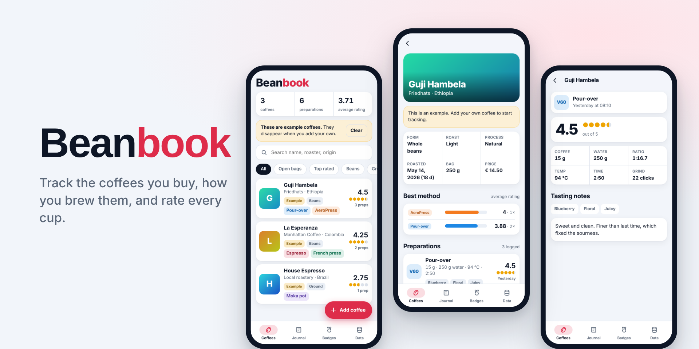

# Beanbook

Beanbook is a coffee journal for your phone. Log every bag of coffee you buy, every way you
prepare it, and how each cup tasted. Over time it shows which coffees and which brew methods
you like best.

It is a web app you can install on your home screen. It works offline, needs no account, and
keeps your data on your own device.

## What you can do

- **Keep a coffee shelf.** Add each bag with its roaster, origin, process, roast level (a slider
  from light to dark), roast date, bag size, price and a photo. Optional details such as region,
  producer, variety, altitude and the roaster's tasting notes sit behind "Show more details". Mark
  a bag finished when it is empty.
- **Log each preparation.** Pick a brew method (espresso, pour-over, AeroPress, French press, moka
  pot, Chemex and more, or add your own such as a Hario Switch). Enter dose, water, temperature,
  brew time and grind. The brew ratio is worked out for you, and "Brew again" copies a recipe.
- **Use advanced options when you want them.** Pouring stages for pour-over methods and settings per
  method (pre-infusion and pressure for espresso, inverted AeroPress, cold brew steep time). They are
  hidden until you tick "Show advanced options".
- **Rate and describe every cup.** Rate from 0 to 5 in quarter steps, pick tasting notes (berry,
  chocolate, floral…) and write your own notes. Add a photo; you can crop and rotate it.
- **See what works.** Each coffee page compares the average rating per brew method. The journal lists
  every cup, newest first, and the Data page shows your favourite method and best coffee.
- **Earn badges.** 23 badges, many with several levels, for exploring origins and methods, brewing
  streaks, early and late cups, fresh roasts, finished bags and more.
- **Own your data.** Export everything (coffees, preparations, photos, badges) to one timestamped
  file, and import it on another device. Exports from older versions always keep working.

## Privacy

Nothing is uploaded. Data is stored in the browser on your device (IndexedDB). There is no
account, no tracking and nothing shared with other users. Use Export now and then as a backup.

## Install on your phone

Open the published site (shown under **Settings → Pages** in this repository) and choose
**Add to Home screen**. After the first visit the app also works offline.

## Development

Requires Node 20 or newer. The app has no runtime dependencies.

```sh
npm run dev           # http://localhost:5173, serves the source as ES modules, no build step
npm run build         # writes dist/: one self-contained index.html plus the files in public/
npm run preview       # build, then serve dist/
npm install && npx playwright install chromium   # once, for the two commands below
npm test              # build, then run the browser smoke test
npm run readme-image  # re-render docs/images/header.png
```

```
src/                  application source (see docs/ARCHITECTURE.md)
  app/                entry point, router, rendering, action table, event listeners
  core/               small pure helpers: dates, formatting, validation, DOM
  domain/             data schema, record normalisers, brew methods, pick-lists
  data/               state, storage, loading, example data
  features/           coffees, brews, journal, badges, backup, photos
  ui/                 icons, sheets, toasts, shared snippets
  styles/             CSS, in the order listed in styles/main.css
public/               copied into the build as is: service worker, web app manifest, icons
scripts/              build, dev server, README image renderer
tests/                end-to-end smoke test
tools/catalog-scraper/  coffee catalog scraper (switched off, see below)
docs/                 architecture notes and the README image
```

Read [docs/ARCHITECTURE.md](docs/ARCHITECTURE.md) before adding features. It explains the layers,
how a click is handled, and the rules for changing the data format.

## Publishing

Every push to `main` runs [`.github/workflows/publish.yml`](.github/workflows/publish.yml). It:

1. builds `dist/` and publishes it with GitHub Pages;
2. runs the smoke test, re-renders the header image at the top of this README from the new build,
   and commits it if the app looks different.

One-time setup for a new copy of the repository: **Settings → Pages → Source: GitHub Actions**.

## Coffee catalog (switched off)

An earlier version suggested coffees while typing, from a catalog built by a scraper of roaster web
shops. It was switched off because too many items that are not a single bag of coffee got through.
The scraper and its last catalog are kept in `tools/catalog-scraper/`. To try it again, run the
workflow by hand with **Update the coffee catalog** ticked, or locally:

```sh
python3 tools/catalog-scraper/beanbook_scraper.py --dry-run
```
